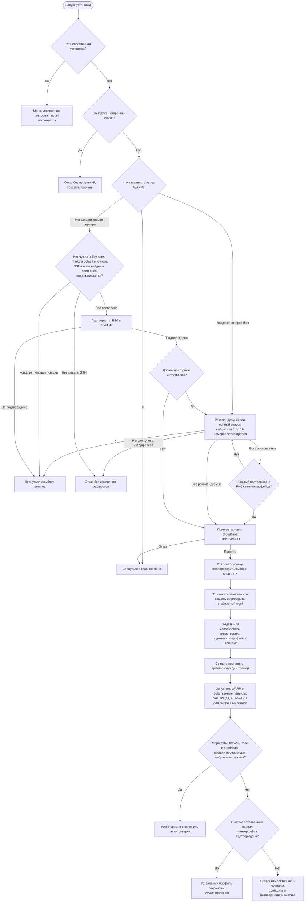
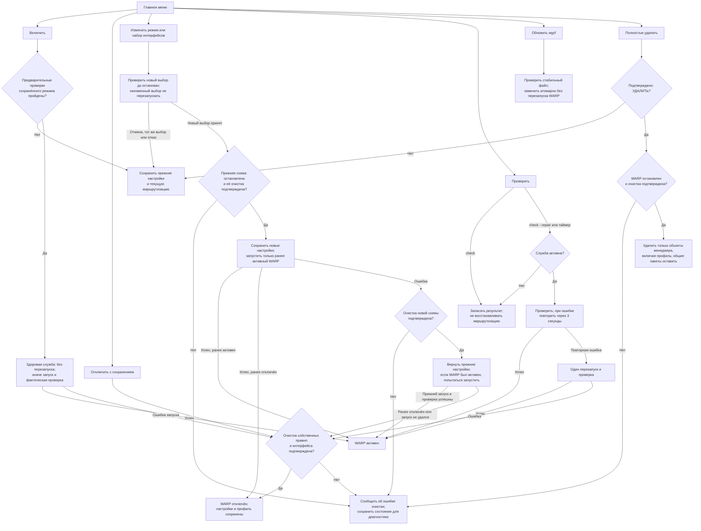

# Менеджер WARP-маршрутизации

Автономный Bash-скрипт для Linux, который устанавливает бесплатный Cloudflare WARP и управляет IPv4-маршрутизацией в одном из двух режимов:

- через WARP проходит трафик, пришедший с одного или нескольких выбранных интерфейсов;
- через WARP проходит исходящий IPv4-трафик самого сервера; при необходимости можно добавить выбранные входные интерфейсы.

Документация соответствует версии скрипта `1.4.0`.

Скрипт не является частью WDTT Plus, не вызывается Android-приложением и не входит в APK. Он также не настраивает Xray, sing-box, 3x-ui или другие приложения: требуемый входной интерфейс должен существовать заранее.

> [!IMPORTANT]
> По умолчанию показываются только рекомендуемые интерфейсы. Полный список остаётся доступен администратору, но рискованный выбор требует точной фразы `РИСК имя-интерфейса`.

> [!WARNING]
> Режим хоста включается после явного подтверждения. Скрипт сохраняет обычный маршрут ответов на входящие соединения и защищает SSH. Для нестандартной сетевой схемы всё равно проверьте доступность служб; на важном VPS заранее подготовьте web console или Rescue Mode провайдера.

## Изменения в 1.4.0

- До 16 входных интерфейсов могут использовать один WARP-туннель.
- Режим хоста переключает его исходящие соединения; трафик VPN-клиентов включается отдельным выбором интерфейсов.
- Добавлены NAT для режима хоста и сохранение обычного маршрута ответов на входящие TCP/UDP-соединения.
- Оставшийся собственный `warp-selective` восстанавливается по совпадению публичного ключа с сохранённым профилем, в том числе после версий `1.3.2` и `1.3.3`.
- При неудачной смене активной конфигурации менеджер пытается вернуть прежнюю работающую конфигурацию. Ошибки очистки сохраняются для повторной попытки.

## Возможности

- русское интерактивное меню с возвратом на предыдущий шаг;
- автоматическая установка недостающих системных инструментов;
- автоматический поиск последнего стабильного `wgcf` для `amd64` и `arm64`;
- отказ от draft, alpha, beta, RC и нестандартных тегов релиза;
- двойная проверка SHA-256 по `checksums.txt` и `digest` GitHub-релиза;
- отдельная таблица policy routing без добавления WARP-default route в `main`;
- один WARP-туннель для нескольких выбранных интерфейсов;
- обнаружение стороннего WARP, чужих policy rules и firewall-правил;
- безопасное отключение с сохранением регистрации и профиля;
- полное удаление только принадлежащих менеджеру объектов;
- статус, счётчики трафика, handshake, выходной IP и журналы по категориям;
- проверка примерно каждые пять минут (со случайной задержкой до 30 секунд) с одной попыткой восстановления;
- российский формат времени с явной временной зоной сервера.

## Режимы маршрутизации

| Свойство | Выбранные входные интерфейсы | Исходящий трафик сервера |
|---|---|---|
| Что попадает в WARP | Пакеты с `iif` каждого выбранного интерфейса | Локально созданные IPv4-соединения и трафик отдельно выбранных входных интерфейсов |
| Выбор интерфейсов | Номера через пробел, рекомендуемый или полный список | Необязательный дополнительный выбор |
| Основной default route | В таблице `main` не изменяется | В таблице `main` не изменяется; правило `iif lo` выбирает WARP для локального трафика |
| IPv4 forwarding | Включается и сохраняется через sysctl | Включается только при выборе входных интерфейсов |
| Firewall | Общий MASQUERADE и отдельные FORWARD для каждого входного интерфейса | MASQUERADE и MARK для ответов по направлению conntrack; FORWARD только для выбранных интерфейсов |
| Входящие службы | Маршрутизация хоста не переключается | Ответы на входящие соединения, обнаруженные SSH-порты и локальные сети сохраняют `main` |
| IPv6 | Не перенаправляется | Не перенаправляется |

Служебный интерфейс в обоих режимах называется `warp-selective`, а его профиль всегда содержит `Table = off`. Поэтому `wg-quick` сам не заменяет системный default route.

## Схема установки



Если рекомендуемых интерфейсов нет, менеджер предлагает полный список; переход можно отменить. Номера выбираются без повторов, а каждый рискованный интерфейс требует отдельного подтверждения.

## Схема управления после установки



При запуске оставшийся собственный `warp-selective` восстанавливается только после проверки публичного ключа по сохранённому профилю. Чужой или неоднозначный интерфейс не удаляется. Если очистка новой схемы после неудачной перенастройки не подтверждена, сохраняются её настройки; возврат к прежней схеме откладывается.

## Как выбираются интерфейсы

Введите номера через пробел, например `1 3`. Можно выбрать от 1 до 16 разных интерфейсов. Для каждого создаются отдельные правила маршрутизации и FORWARD, а `warp-selective` и NAT остаются общими. Регистрация WARP одна.

Безопасность не определяется только именами `eth0`, `ens3`, `tun0` или `wg0`. Скрипт читает фактическое состояние ядра, sysfs, маршруты и правила.

Интерфейс не попадает в рекомендуемый список, если он:

- обслуживает текущую SSH-сессию;
- имеет default route в любой IPv4-таблице;
- является активным WireGuard с пиром или прослушиваемым портом;
- уже упомянут в стороннем `ip rule`, iptables или nftables;
- не удалось прочитать IPv4-маршруты или правила установленного firewall;
- является физическим интерфейсом, bridge, bond или VRF;
- подчинён другому интерфейсу либо имеет подчинённые интерфейсы;
- имеет пользовательские IPv4-маршруты помимо обычного подключённого маршрута ядра;
- является виртуальным интерфейсом неизвестного назначения;
- является `lo`, неактивен или зарезервирован как `warp-selective`.

Без дополнительного подтверждения допускаются распознанные TUN/TAP, `veth` и свободные WireGuard-интерфейсы, если у них нет перечисленных признаков риска.

В режиме «Только рекомендуемые» выводятся лишь доступные кандидаты. Счётчик внизу учитывает только рискованные интерфейсы, которые действительно можно выбрать в полном списке. `lo`, `warp-selective` и неактивные строки без номера в этот счётчик не входят.

В полном списке:

- пронумерованы только доступные для выбора интерфейсы;
- строки без номера показаны справочно и не выбираются;
- рядом с каждым интерфейсом указаны причина оценки и обнаруженные IPv4-маршруты;
- каждый рискованный интерфейс требует отдельного точного ввода `РИСК имя-интерфейса`.

«Рекомендуемый» означает только отсутствие обнаруженных системных признаков риска, а не математическую гарантию совместимости с любой сетевой схемой.

## Если WARP уже установлен

Собственная установка определяется по защищённому файлу состояния и маркеру владельца. Главное меню переключается на управление, а прямая команда `install` отказывается запускать вторую установку и предлагает `reconfigure` или `enable`. Повторный выбор той же конфигурации ничего не перезапускает.

Перед новой установкой проверяются:

- команда `warp-cli`;
- службы `warp-svc.service` и `cloudflare-warp.service`;
- процесс `warp-svc`;
- каталоги официального клиента Cloudflare;
- характерные WireGuard-профили и интерфейсы;
- обычный IPv4-выход через Cloudflare trace;
- policy routing и default routes для режима всего сервера.

При обнаружении стороннего WARP второй туннель не создаётся. Чужие службы, профили, маршруты и firewall-правила не отключаются и не удаляются.

Проверка использует несколько признаков, а не только имя интерфейса. Тем не менее универсально доказать назначение любой произвольной администраторской схемы невозможно: неоднозначность трактуется консервативно, а детали показываются оператору.

## Режим всего исходящего IPv4-трафика

**Режим всего сервера исправлен в версии `1.4.0`.** Добавлены необходимый NAT и защита ответов на входящие соединения. Теперь исходящие IPv4-соединения самого сервера идут через WARP, а ответы на входящие TCP/UDP-соединения и SSH сохраняют обычный маршрут. Работа этого режима проверена в изолированной среде Linux, включая соединения, открытые до включения WARP.

Полный список позволяет выбрать несколько входных интерфейсов. Режим хоста добавляет правило `iif lo`, которое в Linux соответствует локально созданным пакетам. Невыбранный транзитный трафик сохраняет обычную маршрутизацию.

После подтверждения `ВЕСЬ ТРАФИК` менеджер предлагает дополнительно выбрать VPN-интерфейсы. Чтобы направить через WARP два VPN-интерфейса без изменения выхода самого сервера, используйте первый режим и введите оба номера через пробел.

Перед включением скрипт:

1. запрещает режим при посторонних IPv4 policy rules, MARK/CONNMARK или default route в отдельной таблице;
2. получает серверный порт текущего SSH-соединения из `SSH_CONNECTION`;
3. читает эффективные порты из `sshd -T`;
4. проверяет активные listeners `sshd` и socket activation systemd;
5. проверяет поддержку `ip rule ... ipproto tcp sport`;
6. требует точную фразу `ВЕСЬ ТРАФИК`;
7. разрешает IPv4-адреса endpoint WARP через `main`, включая фактический адрес из WireGuard, если он отличается от предварительного DNS-ответа;
8. сохраняет подключённые локальные сети и ответы со всех обнаруженных SSH-портов в `main`;
9. отмечает ответы на входящие соединения отдельным битом MARK по направлению conntrack и направляет их через `main`, включая соединения, открытые до переключения;
10. добавляет MASQUERADE для WARP, а для выбранных входных интерфейсов — FORWARD и правила `iif`;
11. после переключения проверяет маршрут обычного запроса и ответ `warp=on`.

Если набор SSH-портов изменился после настройки, запуск или автопроверка не считают сохранённую защиту актуальной. Выполните `disable`, затем `reconfigure`, чтобы записать новый набор портов.

Защита входящих TCP/UDP-соединений использует направление `REPLY` в conntrack и бит `0x40000000` метки пакета. Она действует также для уже открытых соединений, когда сервер отправляет данные первым после переключения. При обнаружении сторонней работы с marks автоматическое включение режима хоста запрещено, чтобы сохранить существующую схему. Неотслеживаемые соединения (`NOTRACK`), нестандартные firewall-цепочки и несколько внешних маршрутов требуют отдельной проверки. IPv6 остаётся вне WARP.

## Требования и изменения системы

Для установки и управления нужны:

- Linux с активным `systemd`;
- архитектура `x86_64`/`amd64` или `aarch64`/`arm64`;
- права root;
- доступ к GitHub и API Cloudflare;
- если каких-либо зависимостей ещё нет — `apt`, `dnf`, `yum`, `zypper`, `apk` или `pacman`.

Если необходимые команды отсутствуют, скрипт автоматически устанавливает WireGuard tools, `curl`, `jq`, сертификаты, iproute2, iptables, util-linux и coreutils. Для `apt` перед установкой выполняется `apt-get update`. Уже установленные пакеты не обновляются специально.

Перед регистрацией нужно явно ввести `ПРИНИМАЮ`, подтверждая условия Cloudflare. Используется сторонний клиент `wgcf`, скачанный из официального GitHub-релиза проекта и проверенный до запуска.

## Первый запуск

Готовый архив `warp-interface-manager-v<VERSION>.tar.gz` можно скачать со
страницы выпуска WDTT Plus. Внутри находятся сам скрипт, эта инструкция и
`SHA256SUMS` для проверки файлов. WARP-менеджер остаётся самостоятельным
проектом и не входит в APK.

```bash
chmod +x warp-interface-manager.sh
sudo ./warp-interface-manager.sh
```

После установки меню доступно как:

```bash
sudo warp-interface-manager
```

Пункт `0` при выборе интерфейса возвращает к выбору области маршрутизации, а на экране выбора области — в главное меню. Отказ от условий также возвращает в меню без начала установки.

`scan` и `self-test` не изменяют систему. Для `scan` всё же рекомендуется `sudo`: без root некоторые серверы не позволяют полностью прочитать firewall, поэтому оценка интерфейсов может быть неполной. Для `self-test` root не нужен.

## Обновление установленного менеджера

Публикация новой версии не обновляет файл на сервере автоматически. Команда
`update-wgcf` обновляет только `wgcf`, а `install` предназначена для первой
установки. Если менеджер уже установлен именно этим скриптом, получите
`warp-interface-manager.sh` из нужного коммита этого репозитория (в том числе
без нового релиза). Если используете архив выпуска, сначала проверьте его
файлы командой `sha256sum -c SHA256SUMS`. Из каталога со скачанным скриптом
замените исполняемый файл атомарно:

```bash
bash -n ./warp-interface-manager.sh
sudo install -m 700 ./warp-interface-manager.sh /usr/local/sbin/warp-interface-manager.new
sudo mv -f /usr/local/sbin/warp-interface-manager.new /usr/local/sbin/warp-interface-manager
sudo warp-interface-manager --version
```

Эти команды сохраняют профиль, регистрацию и настройки. После замены включите сохранённую конфигурацию:

```bash
sudo warp-interface-manager enable
sudo warp-interface-manager status
sudo warp-interface-manager check
```

Версия `1.4.0` сама восстанавливает оставшийся собственный `warp-selective`, если его публичный ключ совпадает с сохранённым профилем. Файл runtime и индекс от старой версии для этого не обязательны. При несовпадении ключа скрипт остановится с понятной ошибкой и сохранит чужой интерфейс; удалять интерфейс только по имени нельзя.

Для выбора двух интерфейсов выполните:

```bash
sudo warp-interface-manager reconfigure
```

Выберите первый режим, затем введите два номера через пробел. При выключенном WARP после изменения настроек отдельно выполните `enable`.

## Команды

| Команда | Назначение |
|---|---|
| `scan` | Показать рекомендуемые интерфейсы без изменений системы |
| `install` | Запустить интерактивную установку |
| `enable` | Включить сохранённую конфигурацию после повторного preflight |
| `disable` | Отключить WARP и автопроверку, сохранив профиль и регистрацию |
| `reconfigure` | Изменить режим или набор входных интерфейсов |
| `check` | Проверить маршрут, Cloudflare trace и handshake без перезапуска |
| `check --repair` | При ошибке выполнить один перезапуск; при повторной ошибке отключить WARP |
| `status` | Показать режим, службы, версию `wgcf` и последнюю проверку |
| `stats` | Показать трафик, handshake, endpoint, MTU и выходной WARP-IP |
| `update-wgcf` | Проверить и атомарно заменить `wgcf`, не перезапуская WARP |
| `logs` | Показать события или открыть категории журналов в интерактивном терминале |
| `remove` | Полностью удалить локальные объекты менеджера после слова `УДАЛИТЬ` |
| `self-test` | Проверить обработку профиля и метаданных релиза без изменения системы |
| `--version` | Показать версию менеджера |
| `--help` | Показать встроенную справку |

Пример:

```bash
sudo warp-interface-manager status
sudo warp-interface-manager check
sudo warp-interface-manager check --repair
```

## Как выбирается `wgcf`

Версия `wgcf` не зафиксирована в скрипте. При установке и `update-wgcf` менеджер:

1. запрашивает `https://api.github.com/repos/ViRb3/wgcf/releases/latest`;
2. требует `draft: false` и `prerelease: false`;
3. принимает только тег `vX.Y.Z` или `X.Y.Z`;
4. выбирает ровно один Linux-файл для текущей архитектуры;
5. принимает только ожидаемые GitHub download URL;
6. ограничивает размер метаданных, checksum-файла и бинарника;
7. сравнивает SHA-256 из `checksums.txt`, `digest` GitHub API и скачанного файла;
8. проверяет команды и параметры CLI, необходимые для `register` и `generate`;
9. при наличии регистрации проверяет, что новый файл способен прочитать её и создать профиль;
10. только после этого атомарно заменяет локальный `wgcf`.

Alpha, beta, RC, draft, неоднозначные assets, неподходящий URL, несовпадающий SHA-256 или несовместимый CLI приводят к отказу без замены рабочего файла.

## Проверки и откат

Перед признанием запуска успешным проверяются:

- отсутствие `warp-selective` в таблице `main`;
- маршрут от внутреннего WARP-адреса через `warp-selective`;
- ответ Cloudflare `warp=on` или `warp=plus`;
- ненулевой WireGuard handshake;
- собственный маршрут и NAT; состояние, правила маршрутизации, FORWARD и `rp_filter` каждого выбранного интерфейса, а также IPv4 forwarding;
- для режима хоста — защита входящих ответов, локальных сетей, SSH и WARP endpoint;
- для всего сервера — также маршрут обычного IPv4-запроса через WARP.

При неудаче журнал указывает этап: маршрут, Cloudflare trace, рукопожатие, правила для интерфейса, NAT/FORWARD либо защиту SSH и WARP endpoint.

При ошибке запуска менеджер удаляет только свои route/rule/firewall-правила, опускает собственный интерфейс и сохраняет состояние `failed`. Принадлежность интерфейса подтверждается его публичным ключом и защищённым профилем менеджера. Если `wg-quick down` оставил интерфейс, перед прямым удалением повторно проверяются ключ и неизменность индекса. При неподтверждённой принадлежности, ошибке удаления правил или неудачной остановке состояние сохраняется для диагностики и повторной очистки. Регистрация и профиль остаются для последующего `enable`.

Так же восстанавливается интерфейс, оставшийся после версии `1.3.2`, когда индекс ещё не записывался. Совпадение только имени интерфейса не считается подтверждением.

`disable` удаляет активную маршрутизацию, отключает автозапуск службы и таймера, но сохраняет настройки. `enable` выполняет preflight заново; уже работающий WARP проверяется без перезапуска. Автовосстановление повторяет неудачную проверку через 3 секунды и перезапускает службу только при повторном сбое. Смена режима при выключенном WARP сохраняет выбор без запуска службы. При неудачной активной реконфигурации после подтверждённой очистки новой схемы менеджер возвращает прежние настройки и пытается запустить их с проверкой. Если восстановление не удалось, прежние настройки остаются при отключённом WARP. При неполной очистке сохраняются настройки новой схемы.

При удалении менеджера его файл `sysctl.d` удаляется, но текущее значение `net.ipv4.ip_forward` принудительно не выключается: пересылка может быть нужна другим VPN и службам. После перезагрузки действуют оставшиеся системные настройки.

Это fail-open, а не kill switch: при отключении или неудачном восстановлении трафик может вернуться к обычному маршруту. Строгую блокировку прямого выхода нужно проектировать отдельно под конкретный сервер.

## Журналы и время

Сырые сообщения установки не выводятся сплошным потоком в меню. Они сохраняются с правами `600`:

```text
/var/log/warp-interface-manager/events.log
/var/log/warp-interface-manager/install.log
```

Системные журналы доступны из меню и напрямую:

```bash
sudo journalctl -u warp-interface-manager.service -n 50 --no-pager
sudo journalctl -u warp-interface-manager-check.service -n 50 --no-pager
```

Меню «Журналы» разделяет события менеджера, подробности установки, службу маршрутизации и автоматические проверки. Старые ISO timestamps преобразуются только при просмотре; файлы истории не переписываются.

Время отображается по часам и временной зоне самого сервера в формате `ДД.ММ.ГГГГ ЧЧ:ММ:СС ЗОНА (+смещение)`, например `03.09.2026 18:29:15 UTC (+00:00)`. Скрипт не меняет системное время или timezone и не переводит его принудительно в Москву. Во внутренних файлах остаются ISO timestamps и Unix epoch, поэтому формат интерфейса не влияет на systemd-таймеры и маршрутизацию.

## Управляемые объекты

Менеджер использует только собственные имена и маркеры:

```text
/usr/local/sbin/warp-interface-manager
/usr/local/lib/warp-interface-manager/
/etc/warp-interface-manager/
/etc/wireguard/warp-selective.conf
/etc/sysctl.d/90-warp-interface-manager.conf
/var/lib/warp-interface-manager/
/var/log/warp-interface-manager/
/run/warp-interface-manager/
/etc/systemd/system/warp-interface-manager.service
/etc/systemd/system/warp-interface-manager-check.service
/etc/systemd/system/warp-interface-manager-check.timer
```

Состояние, регистрация и ключи имеют ограниченные права. Существующие объекты без правильного маркера владельца не перезаписываются. Общие системные пакеты при `remove` не удаляются, поскольку могут использоваться другими приложениями.

После полного удаления менеджер убирает собственный файл `sysctl.d`, но не
выключает текущее значение IPv4 forwarding: его могут использовать другие
службы. После перезагрузки действуют оставшиеся настройки системы.

> [!NOTE]
> У `wgcf` нет команды удаления созданной записи устройства на стороне Cloudflare. `remove` стирает локальную регистрацию и ключи, но серверная запись Cloudflare может сохраниться.

## Самопроверка проекта

Встроенная проверка не меняет маршрутизацию и не требует root:

```bash
./warp-interface-manager.sh self-test
```

Расширенный тестовый набор использует временные каталоги и команды-моки:

```bash
bash -n warp-interface-manager.sh
bash tests/run-tests.sh
```

Он проверяет выбор нескольких интерфейсов, совместимость старого состояния, оба режима policy routing и их сочетание, защиту входящих ответов, восстановление по ключу, ошибки частичной очистки, возврат прежней рабочей конфигурации, сохранность регистрации и профиля. Встроенная самопроверка дополнительно проверяет профиль и метаданные стабильного релиза `wgcf`.

Для проверки настоящего WireGuard, маршрутов и TCP/UDP используется отдельный контейнер без внешней сети. Команды выполняются из корня репозитория:

```bash
docker build -t wdtt-warp-tests:local -f warp-interface-manager/tests/Dockerfile warp-interface-manager/tests
docker run --rm --network none --cap-add NET_ADMIN --cap-add SYS_ADMIN \
  --security-opt apparmor=unconfined -e LC_ALL=C.UTF-8 \
  -v "$PWD/warp-interface-manager:/project:ro" \
  wdtt-warp-tests:local python3 tests/network-tests.py
```

Дополнительные права нужны только тестовому контейнеру для его сетевых пространств имён и sysctl. Каталог проекта подключается для чтения; сеть хоста и его службы не используются. Сетевые проверки охватывают два выбранных и один посторонний входной интерфейс, режим хоста, совмещённый режим, настоящий handshake, HTTP, UDP/DNS, входящие TCP/UDP-ответы и сохранение сторонних firewall-правил. Они не проверяют доступность Cloudflare на конкретном VPS.

## Ограничения

- поддерживается только IPv4;
- это не kill switch;
- защита SSH не заменяет web console или Rescue Mode;
- нестандартные firewall-схемы и неотслеживаемые входящие соединения требуют отдельной проверки;
- скрипт создаёт только собственный `warp-selective`, но не создаёт выбранные TUN/WireGuard/`veth` интерфейсы приложений;
- скрипт не объединяет две чужие VPN/WARP-схемы и не удаляет их правила;
- назначение полностью произвольной сетевой конфигурации невозможно определить со стопроцентной гарантией.

## Изоляция проекта

Каталог `warp-interface-manager/` является отдельным проектом внутри репозитория. Он не подключён к Android-модулям и APK-ресурсам, не импортирует код приложения и не управляет его конфигурацией. Предрелизная задача Gradle лишь создаёт из скрипта и README отдельный проверяемый архив рядом с APK и серверным комплектом.
